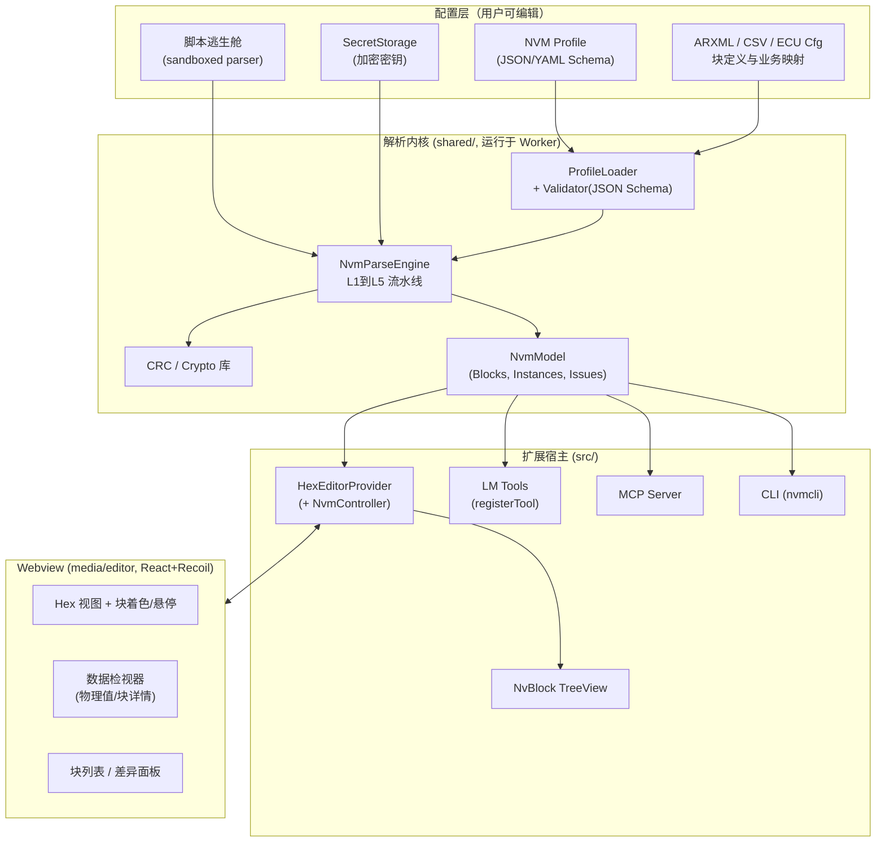
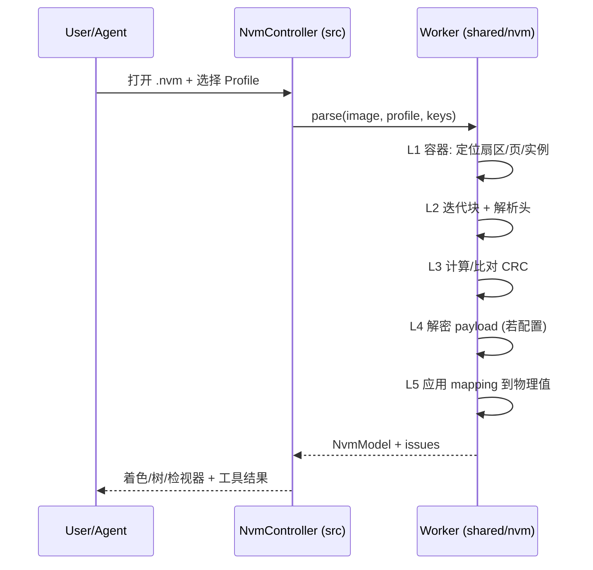

# AUTOSAR NVM Studio —— 基于 vscode-hexeditor 的通用 NVM 解析与 AI 分析平台设计

> 本文档描述如何在 [`vscode-hexeditor`](../README.md) 的基础上，吸收 `NvmAnalyzer`（C# / WinForms 工具）的 AUTOSAR NVM 解析能力，并将其重构为一个**配置驱动、厂商无关、AI 辅助**的现代化 VS Code 插件。

---

## 1. 愿景与设计原则

将 hexeditor 从"通用十六进制编辑器"升级为 **AUTOSAR NVM Studio**：一个既保留底层字节编辑能力、又能在业务层面理解任意厂商 NVM 镜像、并可被 AI/Agent 驱动的分析平台。

核心设计原则：

| 原则                             | 说明                                                                                                                                                                                                                        |
|----------------------------------|-----------------------------------------------------------------------------------------------------------------------------------------------------------------------------------------------------------------------------|
| **配置即方案（Config-as-Scheme）** | 所有解析规则（分区、块定位、头结构、CRC、加密、数据元素）均来自可编辑的配置，而非硬编码。`NvmAnalyzer` 里 `NvmVector.cs` / `NvmElectrobit.cs` / `NvmInfineon.cs` 等每个厂商一个 `.cs` 的做法，将被**一套声明式 Profile Schema** 取代。 |
| **厂商无关（Vendor-Agnostic）**    | 通过 Profile 描述即可支持 Vector / EB / Freescale-NXP / Infineon / Conti 及任意新供应商，无需改插件源码。                                                                                                                     |
| **用户自定义解析格式**           | 提供两级自由度：①声明式 Profile（覆盖 95% 场景）；②脚本逃生舱（Sandboxed JS/TS 解析器，覆盖极端私有格式）。                                                                                                                         |
| **业务级块定义**                 | 块 ID → 名称 → 数据元素 → 物理值的映射来自 AUTOSAR 配置（ARXML / DBC-like / 用户 CSV），可回溯业务含义。                                                                                                                        |
| **AI 原生（AI-Native）**           | 内置 Language Model Tools、MCP Server 与 CLI，使 GitHub Copilot / 任意 Agent 都能调用解析与分析能力。                                                                                                                          |
| **性能优先**                     | 大文件懒加载、Web Worker 解析、增量渲染，沿用 hexeditor 现有的虚拟滚动与分页读取机制。                                                                                                                                          |
| **现代化交互**                   | 复用 hexeditor 的 Webview（React + Recoil），提供块树、着色、悬停、数据检视器、差异对比等人性化 UI。                                                                                                                                |

---

## 2. 目标与非目标

**目标**
- 解析任意 AUTOSAR NVM / FEE / EA 二进制镜像，识别块边界、校验 CRC、解密、并映射业务含义。
- 全部规则由配置文件驱动，用户可自由定义解析格式与块定义。
- 在 Hex 视图上着色渲染块、提供块树、悬停详情、物理值解释。
- 暴露 AI 工具 / MCP / CLI，供 Copilot 与 Agent 调用。
- 保留 hexeditor 原有编辑、搜索、diff 能力。

**非目标（首期）**
- 不做 ECU 在线刷写 / 诊断通信（UDS/CAN）。
- 不内置任何厂商专有密钥（密钥由用户在本地安全存储中提供）。
- 不追求与 `NvmAnalyzer` 逐像素一致的 WinForms UI，而是重新设计现代化交互。

---

## 3. 从 NvmAnalyzer 提取的能力清单

对 `NvmAnalyzer` 源码的分析表明，其核心价值可归纳为**五个可配置层**。下表将 C# 中各厂商实现"翻译"为 Profile 能力维度：

| 能力层                     | NvmAnalyzer 中的体现                                                                                                                                                                   | 抽象为配置的方式                                                                                              |
|----------------------------|----------------------------------------------------------------------------------------------------------------------------------------------------------------------------------------|---------------------------------------------------------------------------------------------------------------|
| **L1 容器/仿真层（FEE/EA）** | `NvmElectrobit.cs`（扇区/页/擦除计数/active 标志 0xAAAA）、`NvmVector.cs`（Link Table）、`NvmFreescale.cs`（Cluster 轮转 ValFlg=0x81FFFFFF）、`NvmInfineon.cs`（128B Page Descriptor，magic 0x59） | `container` 声明：扇区大小、页大小、状态标志、擦除计数器位置、link-table/cluster 布局、"选择最新有效实例"策略       |
| **L2 块定位与头解析**      | 各 `Nvm*.cs` 的 header 布局（tag/id/length/address/crc/status/counter 的偏移与字节序）                                                                                                   | `block.header` 字段列表：`{ name, offset, size, endian, role }` + `block.iterate` 迭代策略（marker/link/static） |
| **L3 完整性校验**          | `Crc8.cs`(poly 0xD5/0x1D)、CRC16(0x1021,init 0xFFFF,reflected)、`Utils.Crc32`(0x1EDC6F41,reflected)、`FeeCRC`/`Fee2CRC`                                                                   | `integrity.crc`：`{ width, poly, init, refIn, refOut, xorOut, range }`，内置常用预设 + 自定义                   |
| **L4 加密/解密**           | `BlockDecrypt.cs` / `BlkDcryptKey.cs`：AES-CBC-128/256、AES-GCM-256、CMAC；按 ECU 存密钥                                                                                                   | `crypto`：`{ algo, keyRef, ivRef/ivMode, tagLen }`，密钥来自 VS Code SecretStorage                              |
| **L5 数据元素解释**        | `NvmDataStruct.cs`（Cat2 寄存器、温度=raw−80）、ARXML CompuMethod、CIF/MOTF 解析                                                                                                            | `layout`：记录/数组/位域字段 + `compu`（线性 `phys=raw*f+o`、枚举表、位掩码）                                      |

此外，`CifParser.cs` / `MotfParser.cs` / `NaEcuConfigs/*.cfg` 对应**配置导入**能力：将厂商 ECU 配置转换为本插件的 Profile。

---

## 4. 总体架构



**关键分层与复用**
- **`shared/`**：新增 `nvm/` 内核（Profile 类型、解析引擎、CRC/Crypto、模型）。因 `shared/` 已被 `diffWorker` 用于 Worker，NVM 解析同样可运行在 Worker 中，避免阻塞 UI。
- **`src/`**：新增 `NvmController`，桥接内核与 `HexEditorProvider`；注册 TreeView、LM Tools、MCP、CLI。
- **`media/editor/`**：扩展现有 Webview（已存在 `SetNvmBlocks` 协议、`selectedNvmBlockAtom`、块悬停样式的雏形），完成块着色、块面板、物理值检视。

---

## 5. 核心数据模型

```typescript
// shared/nvm/model.ts
export interface NvmModel {
    profileId: string;
    sectors: NvmSector[];            // L1 容器层解析结果
    blocks: NvmBlock[];              // 已选出的"最新有效实例"
    allInstances: NvmBlockInstance[];// 全部实例（含历史/无效），供审计
    issues: NvmIssue[];              // CRC 失败、越界、无法解密等
}

export interface NvmBlock {
    logicalId: number | string;      // 逻辑块 ID
    name?: string;                   // 来自 ARXML/CSV 的业务名
    active: NvmBlockInstance;        // 当前有效实例
    history: NvmBlockInstance[];
}

export interface NvmBlockInstance {
    logicalId: number | string;
    fileRange: { start: number; end: number }; // 在镜像中的字节范围
    header: Record<string, number>;  // 解析出的头字段
    payloadRange: { start: number; end: number };
    crc: { stored?: number; computed?: number; valid?: boolean };
    crypto?: { algo: string; decrypted: boolean };
    version?: number;                // 版本/写计数/擦除计数
    datasetIndex?: number;
    status: "valid" | "invalid" | "empty" | "encrypted";
    decoded?: DecodedField[];        // L5 物理值
}

export interface DecodedField {
    path: string;                    // e.g. "Header.Temperature"
    rawBytes: [number, number];      // payload 内偏移范围
    raw: number | bigint | string;
    value: number | string | boolean;
    unit?: string;
    enumLabel?: string;
}

export interface NvmIssue {
    severity: "error" | "warning" | "info";
    code: string;                    // "CRC_MISMATCH" | "DECRYPT_FAIL" | ...
    blockId?: number | string;
    fileRange?: { start: number; end: number };
    message: string;
}
```

模型对 Webview（着色/树/检视器）、LM Tools、MCP、CLI 是**唯一事实来源（single source of truth）**。

---

## 6. 配置驱动的解析引擎（核心）

### 6.1 Profile Schema 总览

一个 **NVM Profile** 是描述"如何把一段字节解析成块"的声明式文档（JSON 或 YAML，附 JSON Schema 校验与编辑器补全）。它由五个可选层组成，对应 §3 的 L1–L5：

```yaml
# 示例：vector-fee.nvmprofile.yaml
id: vendor.vector.fee.v2
name: Vector FEE (v2, AES-CBC)
extends: base.fee            # 可继承基础 Profile，减少重复
endian: little               # 默认字节序，字段可覆盖

container:                   # L1 —— 仿真/容器层（可省略 = 无仿真，线性块）
  kind: link-table           # link-table | cluster | page-descriptor | sector-status | static | none
  sectorSize: 0x10000
  alignment: 8
  linkTable:
    sizeEncoding: nibble-packed   # 描述 Link Table 大小的编码
    dataStartExpr: "linkTableSize * alignment + alignment"
  selectInstance: highest-version # 如何在多实例中选"最新有效"

block:                       # L2 —— 块定位与头
  iterate: marker            # marker | link | fixed-list | descriptor
  endMarker: { at: 0, size: 2, value: 0xFFFF }
  header:
    - { name: tag,      offset: 0, size: 2, endian: big }
    - { name: instExp,  offset: 2, size: 1, role: instanceCount, transform: "1 << (v & 0x0F)" }
    - { name: length,   offset: 3, size: 2, role: payloadLength }
  payload: { after: header, length: "$length" }
  align: 8

integrity:                   # L3 —— CRC
  crc:
    preset: CRC16-CCITT-FALSE   # 或完全自定义见下
    range: payload
    stored: { source: trailer, size: 2, endian: little }

crypto:                      # L4 —— 解密（可省略）
  algo: AES-CBC-256
  keyRef: "ecu:${ecuType}"    # 从 SecretStorage 取密钥
  ivMode: fixed
  iv: "08AA6063E54DD38EA8FD5D1855426C69"
  padToBlock: 16

mapping:                     # L5 —— 业务映射来源
  source: arxml
  ref: "./MyEcu.arxml"        # 或 csv/inline
```

### 6.2 各层规格

**L1 `container`（容器/仿真层）** —— 抽象自 `NvmElectrobit`/`NvmVector`/`NvmFreescale`/`NvmInfineon`：

| `kind`            | 覆盖的 NvmAnalyzer 实现 | 关键参数                                                                                                      |
|-------------------|-------------------------|---------------------------------------------------------------------------------------------------------------|
| `sector-status`   | Electrobit 旧/新页布局  | `sectorSize`, `virtualPageSize`, `statusFlags`(active=0xAAAA/full=0x2222/copied), `eraseCounter{offset,size}` |
| `link-table`      | Vector v1/v2/v3         | `linkTable.sizeEncoding`, `dataStartExpr`, 递归 `chunk` 定义                                                  |
| `cluster`         | Freescale/NXP           | `clusterHeader`(id/startAddr/size/checksum), `validFlag`=0x81FFFFFF, 轮转选择                                 |
| `page-descriptor` | Infineon                | `descriptorSize`=128, `magic`=0x59, `stateCounter{offset,size}`, `descriptorCrc`                              |
| `static`          | Conti EA / ARS3         | 无仿真，块地址固定来自 mapping                                                                                 |
| `none`            | 线性镜像                | 直接进入 L2                                                                                                   |

`selectInstance` 策略：`highest-version` | `highest-erase-counter` | `active-page` | `last-valid`，对应各厂商"找最新有效实例"的算法。

**L2 `block`（头与迭代）**：
- `header[]` 中每个字段：`name / offset / size / endian / role / transform`。`role` 枚举：`blockId | payloadLength | address | crc | status | version | datasetIndex | instanceCount | validity`。
- `transform` 为受限表达式（见 §6.3），如 `"1 << (v & 0x0F)"`、`"(hi << 4) | lo"`（处理 Vector 的 nibble 打包）。
- `iterate` 决定如何走到下一个块：`marker`（终止标志）、`link`（跟随 link table 指针）、`fixed-list`（来自 mapping 的静态地址列表）、`descriptor`（页描述符驱动）。

**L3 `integrity.crc`** —— 完整参数化，覆盖 `Crc8/CRC16/Crc32/FeeCRC/Fee2CRC`：
```yaml
crc:
  width: 16            # 8 | 16 | 32
  poly: 0x1021
  init: 0xFFFF
  refIn: false
  refOut: false
  xorOut: 0x0000
  range: payload       # payload | header | header+payload | custom{start,len expr}
  stored: { source: trailer, size: 2, endian: little }
```
内置预设：`CRC8-SAE-J1850(0x1D)`、`CRC8-0xD5`、`CRC16-CCITT-FALSE`、`CRC16-ARC`、`CRC32`、`CRC32C(Castagnoli 0x1EDC6F41)`。用户可用 `preset` 引用或全量自定义。

**L4 `crypto`**：`algo ∈ {AES-CBC-128, AES-CBC-256, AES-GCM-256, CMAC-128, CMAC-256, none}`；`keyRef` 指向 SecretStorage 条目；`iv` 支持 `fixed | prefix(N bytes) | derive`。解密使用 Node `crypto`（AES-CBC/GCM 原生支持）。**插件绝不内置任何真实密钥**。

**L5 `mapping`**：块 ID → 业务名与数据布局。来源可为：
- `arxml`：解析 `NvBlockNeeds` / `SHORT-NAME` / 数据类型 `ImplementationDataType` + `CompuMethod`（线性/枚举）。
- `csv`：用户提供 `id,name,offset,size,type,scale,offset,unit,enum`。
- `inline`：直接在 Profile 内写 `layout`。

`layout` 字段示例（对应 `NvmDataStruct.cs` 的记录/温度换算）：
```yaml
layout:
  - { path: temperature, type: u8, compu: { linear: { factor: 1, offset: -80 }, unit: "°C" } }
  - { path: state, type: u8, compu: { enum: { 0: OFF, 1: RUN, 2: FAULT } } }
  - { path: registers, type: u32, count: 32, endian: little }
```

### 6.3 表达式与安全沙箱

`transform` / `dataStartExpr` / `selectInstance` 中的表达式使用**极简、无副作用**的求值器（白名单运算符 `+ - * / % << >> & | ~ ()`、变量、`min/max`），**不使用 `eval`/`Function`**，杜绝注入。变量作用域仅限当前解析上下文（header 字段、容器参数）。

### 6.4 脚本逃生舱（最大自由度）

对声明式无法表达的私有格式，Profile 可指定：
```yaml
parser:
  kind: script
  entry: "./custom/myVendor.parser.js"   # 导出 parse(image, ctx): NvmModel
```
脚本运行在 **VM 沙箱（`node:vm` + 冻结上下文）**，仅暴露只读镜像 `Uint8Array`、CRC/Crypto 工具与 `emitBlock()`/`emitIssue()` API，无文件系统/网络访问。这样"用户自己规定解析格式"的诉求得到彻底满足，同时保证安全。

### 6.5 解析流水线



---

## 7. 与 hexeditor 的集成

### 7.1 着色渲染（Decorators）
现有 `shared/decorators.ts` 的 `HexDecoratorType` 仅有 `Insert/Delete/Empty`。扩展为：
```typescript
export enum HexDecoratorType { Insert, Delete, Empty, NvmBlockValid, NvmBlockInvalid, NvmBlockEncrypted, NvmHeader, NvmCrc }
export interface HexDecorator {
    type: HexDecoratorType;
    range: { start: number; end: number };
    nvm?: { blockId: number | string; name?: string; tooltip?: string };
}
```
`NvmController` 将 `NvmModel` 转换为装饰区间：块体按有效性着色（有效=绿、CRC 失败=红、加密=紫、头/CRC 高亮），并附块元数据供悬停。Webview 侧已存在 `nvmBlock` 悬停雏形（见 `media/editor/dataDisplay.tsx`），据此完善。

### 7.2 Webview 协议
现有 `shared/protocol.ts` 已有 `MessageType.SetNvmBlocks`。规范化为：
```typescript
interface SetNvmModelMessage {
    type: MessageType.SetNvmBlocks;
    model: SerializedNvmModel;      // 块范围、状态、名称、issues
}
// Webview → Host
interface SelectNvmBlockMessage { type: MessageType.SelectNvmBlock; blockId: number | string; }
interface RunNvmActionMessage { type: MessageType.RunNvmAction; action: "recalcCrc" | "decrypt" | "export"; blockId?: number | string; }
```

### 7.3 UI 组件
- **NvBlock 树视图**（`src/nvmTreeView.ts`，`TreeDataProvider`）：按扇区/逻辑块分组，显示 ID、名称、CRC 状态图标、版本。点击 → 在 Hex 视图选中并滚动到该块。
- **数据检视器扩展**（`media/editor/dataInspector.tsx`，已有 `selectedNvmBlockAtom`）：选中块时显示头字段表、CRC(stored vs computed)、解密状态、`DecodedField` 物理值表。
- **块面板 / Issues 面板**：列出所有 CRC 失败、越界、解密失败项，可跳转。
- **差异对比**：复用 hexeditor 的 diff 能力，按**逻辑块**对齐两个 NVM 镜像（而非纯字节 diff），忽略擦除计数等易变字段——这也回应了用户附带的"XML/二进制深度比较"诉求。

### 7.4 命令与激活
`package.json` 新增：
- 命令：`hexEditor.nvm.selectProfile`、`nvm.importArxml`、`nvm.recalcCrc`、`nvm.decryptBlock`、`nvm.exportReport`、`nvm.setKey`。
- 配置项：`hexEditor.nvm.profilePath`、`nvm.autoDetectProfile`、`nvm.defaultEndianness`、`nvm.enableCrcValidation`。
- 视图容器：`nvmBlocksView`（Explorer 侧栏）。
- 文件关联：`*.nvm`, `*.bin`, `*.hex` 可"以 NVM Studio 打开"。

---

## 8. AI 辅助能力

三条并行通道，覆盖"嵌入 Copilot / MCP / CLI 给 Agent"的全部诉求：

### 8.1 VS Code Language Model Tools（嵌入 Copilot Chat）
通过 `vscode.lm.registerTool` + `package.json` 的 `contributes.languageModelTools` 注册工具，Copilot Chat 与 `@`-agent 可直接调用：

| 工具名               | 功能                                                             |
|----------------------|------------------------------------------------------------------|
| `nvm_parse`          | 用指定/自动 Profile 解析当前或给定镜像，返回块清单与 issues 摘要  |
| `nvm_getBlock`       | 取某块的头、CRC、payload（hex）、物理值                               |
| `nvm_validateCrc`    | 校验全部/指定块 CRC，返回失败列表                                 |
| `nvm_diff`           | 对比两个镜像的逻辑块差异                                         |
| `nvm_explainBlock`   | 结合 mapping/ARXML 生成块业务含义的自然语言解释（供 LLM 二次总结） |
| `nvm_suggestProfile` | 分析未知镜像的熵/标志位/周期性，**建议** Profile 草稿供用户确认   |

工具返回**结构化 JSON + 简短文本**，让模型既能推理又能引用精确数值。所有工具只读或需显式确认，写操作（重算 CRC、解密后另存）要求用户批准。

### 8.2 MCP Server（供任意 Agent）
提供 `src/mcp/nvmMcpServer.ts`，以 stdio 传输实现 Model Context Protocol，暴露与 §8.1 相同的工具集，使 Claude Desktop / 其他 Agent / CI 机器人都能调用。VS Code 侧可通过 `contributes.mcpServerDefinitionProviders` 声明，便于一键接入。

### 8.3 CLI（`nvmcli`）
`tools/` 下提供独立 Node CLI（复用 `shared/nvm` 内核，零 VS Code 依赖）：
```bash
nvmcli parse image.nvm --profile vector-fee.yaml --json
nvmcli crc image.nvm --block 0x21
nvmcli diff a.nvm b.nvm --by-block
nvmcli report image.nvm --profile p.yaml -o report.md
```
CLI 可被脚本、CI 流水线、以及 Agent 通过 shell 调用；输出稳定 JSON/Markdown。

### 8.4 AI 分析场景
- **异常定位**："帮我找出所有 CRC 失败的块并解释可能原因" → `nvm_validateCrc` + `nvm_explainBlock`。
- **未知格式推断**：`nvm_suggestProfile` 输出 Profile 草稿 → 用户微调 → 迭代。
- **回归对比**："这版与上版哪些标定块变了" → `nvm_diff` 按逻辑块。
- 使用 VS Code `LanguageModelChat` API 时，将结构化模型数据作为上下文喂给 Copilot，避免让 LLM 直接读原始字节。

---

## 9. 性能设计

- **Worker 解析**：解析内核置于 `shared/nvm`，运行在 Web Worker（沿用 `initWorker.ts` / `diffWorker.ts` 模式），不阻塞 UI。
- **懒加载与分页**：复用 hexeditor 的 `FileAccessor` 分块读取；容器层可先扫描扇区/link-table 元数据，块 payload 按需读取。
- **增量装饰**：仅为视口附近块生成 decorator，滚动时按需补充。
- **CRC 表缓存**：CRC8/16/32 查表在 Profile 加载时预计算并缓存（与 `Crc8.cs` 一致）。
- **大文件**：对 >100MB 镜像，容器层用流式扫描 + 索引，避免整文件驻留。

---

## 10. 安全

- **无内置密钥**：密钥经 `context.secrets`（SecretStorage）由用户录入，Profile 仅存 `keyRef`。
- **表达式/脚本沙箱**：§6.3 白名单求值器 + §6.4 `node:vm` 冻结上下文；脚本无 FS/网络。
- **配置来源可信**：加载外部 Profile/ARXML 时校验 JSON Schema，并提示来源；对脚本 Profile 需用户显式信任工作区。
- **AI 工具边界**：默认只读；解密/写回/导出需用户确认；遵循 OWASP，防止路径穿越与注入。
- **提示注入防护**：AI 工具返回内容不作为指令执行；对来自文件/配置的文本做转义。

---

## 11. 目录结构（规划）

```
shared/
  nvm/
    profile.ts          # Profile 类型 + JSON Schema
    profileLoader.ts    # 加载/校验/继承(extends)
    engine.ts           # L1–L5 流水线
    container/          # sector-status | link-table | cluster | page-descriptor
    crc.ts              # 可配置 CRC8/16/32 + 预设
    crypto.ts           # AES-CBC/GCM/CMAC
    mapping/            # arxml.ts | csv.ts | compu.ts
    expr.ts             # 安全表达式求值
    sandbox.ts          # 脚本逃生舱
    model.ts            # NvmModel 等
src/
  nvm/
    nvmController.ts    # 桥接内核与 HexEditorProvider
    nvmTreeView.ts      # 块树
    nvmDecorators.ts    # 模型到装饰
    arxmlImport.ts      # ARXML/CIF/MOTF 导入向导
  lm/nvmTools.ts        # Language Model Tools
  mcp/nvmMcpServer.ts   # MCP Server
media/editor/
  nvm/                  # 块面板、检视器扩展、着色（复用现有 nvm 雏形）
tools/
  nvmcli.ts            # CLI 入口
  profiles/            # 内置示例 Profile（vector/eb/freescale/infineon/conti）
```

> 现有 `src/nvm/arxmlParser.ts`、`src/nvm/blockMapper.ts` 作为早期原型，将并入 `shared/nvm/mapping` 与 `engine` 并按上述架构重构。

---

## 12. 实施路线图

| 阶段                 | 里程碑                   | 内容                                                                                 |
|----------------------|--------------------------|--------------------------------------------------------------------------------------|
| **M0 内核骨架**      | 可解析线性块             | Profile Schema、`engine`(L2)、可配置 `crc`(L3)、`model`；CLI `parse`/`crc`；单测          |
| **M1 容器层**        | 支持 FEE/EA              | `sector-status`/`link-table`/`cluster`/`page-descriptor` + 选实例策略；用真实样本回归 |
| **M2 UI 集成**       | Hex 着色 + 块树 + 检视器 | 装饰扩展、TreeView、Webview 协议、悬停/物理值                                           |
| **M3 加解密 + 映射** | 解密 + 业务含义          | `crypto`(L4)、SecretStorage、ARXML/CSV `mapping`(L5)、CompuMethod                       |
| **M4 AI 通道**       | Copilot/MCP/CLI          | Language Model Tools、MCP Server、`nvm_suggestProfile`、报告导出                        |
| **M5 自由度与打磨**  | 脚本逃生舱 + diff + 性能 | 沙箱解析器、按逻辑块 diff、大文件优化、示例 Profile 库、文档                             |

每阶段交付**最小可用增量（MVP）**，先跑通单一厂商单块，再逐步扩展。

### 12.1 已实现进度（截至当前）

- **M0 内核**：`shared/nvm` —— `model` / 可配置 `crc`（6 预设，含 CRC16-CCITT-FALSE、CRC32/32C）/ 安全表达式 `expr` / 线性块 `engine` / Profile 校验；CLI `parse`/`crc`；单测通过。
- **加载器**：`shared/nvm/loaders.ts` —— Motorola S-record（S1/S2/S3，校验和验证）+ Intel HEX + 自动识别，产出 `MemoryImage`（稀疏段、绝对地址读取、展平填充）。已在真实 `NVM 1.mot` 上验证：base `0x3A0000`、span `0x60000`（=2×`0x30000`）。
- **结构体解码（L5 基础）**：`shared/nvm/struct.ts` —— 兼容 NvmAnalyzer `.blk` 格式（`Title;Unit;Bits;Endian;Type;Opers`），支持 `* / + - & |`、`(uN)/(iN)` 转型、位/字节字段、符号扩展，输出 `DecodedField` 供"点击区域→右侧检视器"使用。
- **富结构体解码（L5 完整，SDK v3）**：`shared/nvm/structRich.ts` —— `NvmStructDef`/`NvmStructCatalog` +
  `decodeStructRich` 产出**解码树**：标量(u8..u64/i8..i64/f32/f64/bool/bytes/ascii)、数组(含 2 维 freeze-frame)、
  嵌套 struct、位域(MSB/LSB)、显式 offset/padding/align、每字段字节序、`compu`(线性/枚举/opers)；u64 以 string
  上线、绝对偏移、绝不抛异常。三种来源统一：内联 JSON、C 源码(`cstruct.ts`)、ARXML(`arxmlStructs.ts`)；
  `compileBlkToRich` 保证旧 `.blk` 逐字段一致。经 `EngineSdk`(v3) 注入引擎，引擎按 `options.blockStructs` 绑定
  并对 payload 解码 → `NvmBlockInfo.decoded` → Data Inspector 可折叠树(`media/editor/dataInspector.tsx`
  `NvmDecodedTree`)。CLI `decode-rich`。已在真实 `NVM_22.11_9.mot` 端到端验证。
- **ARXML 配置导入**：`shared/nvm/arxml/` —— 无依赖 XML 解析器 + 通用 ECUC 读取器 + `importNvmCatalog`（直接读 NvM/Fee/Fls ECUC，**不依赖生成的 C 文件**）。已在真实 ARS620_S2A2 上验证：导出 80 个块（id/len/crc宽度/管理类型/实例数=2^n−1/FeeBlockNumber）、`FeeVirtualPageSize`、扇区布局（`0x3A0000`×`0x10000`×6）。CLI `import`/`image`/`decode`。

### 12.2 开放待办（Open TODOs）

- ~~**[TODO-B] 块 → 结构体 映射来源未定**~~ **已解决（SDK v3，见 §12.1）**：block↔struct 绑定由
  **vendor engine** 通过 `*.nvmlayout.json` 的 `options.blockStructs` 声明（按 block 名 / glob /
  tag(=FeeBlockId) / identity 绑定），结构体来源三选（内联 JSON / 生成的 C 源码 / ARXML）统一编译为
  `NvmStructCatalog`。engine 对被绑定 block 调 `sdk.decodeStructRich` 产出解码树，经
  `NvmBlockInfo.decoded` 送 webview，由 Data Inspector 渲染为可折叠、可点击 reveal 的树。核心保持厂商无关。
  详见 [nvm-layout-providers.md](nvm-layout-providers.md) §3d。
- **[TODO-C] CRC 校验策略（`IgnoreCrc; true`）**：ARS620 的 NvmAnalyzer 配置为 `IgnoreCrc=true`。**决策**：解析阶段默认**不**因 CRC 失败而判定块无效，仅在检视器中展示 `stored vs computed` 供参考；是否强制校验作为 Profile/用户开关（`integrity.enforce`）。待与真实数据核对 Vector FEE 的 CRC 计算范围后再决定是否默认开启。
- **[TODO-Vector] Vector FEE(V2) 容器解析（L1）**：按 link-table + chunk（`MEMSTACK=VECTOR2`、`SECT_SIZE=0x30000`、`Alignment`、`FeeVirtualPageSize`）定位每个 `FeeBlockNumber` 的最新有效实例，产出块的实际字节范围，叠加 `importNvmCatalog` 的定义与 `.blk` 结构体完成端到端解析。
- **[TODO-Import] AUTOSAR 元模型形式化**：当前用轻量 ECUC 读取器；如需更严格，可选接入 `autosar_parser`（`D:\02_Work\repo\Others\autosar_parser`）离线预处理生成 Profile。生成的 GenData C 文件仅在 ARXML 缺项时作为兜底。

---


## 13. 测试策略

- **单元测试**：CRC 各预设（对照已知向量）、表达式求值、header 解析、容器选实例、CompuMethod 换算。
- **Profile 快照测试**：对每个内置 Profile + 脱敏样本镜像，快照 `NvmModel`，防回归。
- **集成测试**：Extension Development Host 中打开样本，验证着色/树/检视器/命令。
- **CLI/MCP 契约测试**：固定输入 → 稳定 JSON 输出。
- **性能基准**：大镜像解析与滚动帧率。
- **安全测试**：恶意表达式/脚本被拒绝、路径穿越防护、密钥不落盘明文。

---

## 14. 附录 A：厂商格式速查（源自 NvmAnalyzer，映射为 Profile 参数）

| 厂商/格式     | 容器 kind         | 块 ID             | CRC                  | 字节序 | 加密        | 选实例                    | NvmAnalyzer 源         |
|---------------|-------------------|-------------------|----------------------|--------|-------------|---------------------------|------------------------|
| Vector v1     | link-table        | 2B tag            | 1B                   | 混合   | 可选        | highest-version           | `NvmVector.cs`         |
| Vector v2     | link-table        | 2B tag(LE)        | 2B@尾 CRC16/FFFF     | 小端   | AES-CBC/GCM | highest-version           | `NvmVector2.cs`        |
| Vector v3     | link-table(chunk) | 2B tag(LE)        | 2B@尾                | 小端   | AES-CBC/GCM | chain                     | `NvmVector3.cs`        |
| Electrobit    | sector-status     | 2B ID(LE)         | FeeCRC(9B 头)        | 小端   | AES-CBC     | active-page/erase-counter | `NvmElectrobit.cs`     |
| EB EA         | static/none       | 隐式              | CRC16/FFFF           | 小端   | 无          | last-valid                | `NvmEaElectrobit.cs`   |
| EB MMCA       | static            | 隐式              | CRC16 可选(描述符位) | 小端   | 无          | last-valid                | `NvmMmcaElectrobit.cs` |
| Freescale/NXP | cluster           | 2B(LE)            | Fee2CRC              | 小端   | AES-CBC     | validFlag=0x81FFFFFF      | `NvmFreescale.cs`      |
| Infineon      | page-descriptor   | 2B(LE)            | Fee2CRC + PD-CRC32C  | 小端   | AES-CBC     | highest state-counter     | `NvmInfineon.cs`       |
| Conti ARS3    | static            | 隐式(config 地址) | CRC16/FFFF           | 小端   | 无          | static                    | `NvmEaArs3.cs`         |
| Conti MFC5    | sector(sections)  | 块名              | CRC16/FFFF           | 小端   | AES-CBC     | 顺序                      | `NvmMfc5.cs`           |

## 15. 附录 B：CRC 预设

| 预设名            | width | poly       | init       | refIn | refOut | xorOut     | 来源                     |
|-------------------|-------|------------|------------|-------|--------|------------|--------------------------|
| CRC8-0xD5         | 8     | 0xD5       | 0x00       | false | false  | 0x00       | `Crc8.cs` poly1          |
| CRC8-SAE-J1850    | 8     | 0x1D       | 0xFF       | true  | true   | 0xFF       | `Crc8.cs` poly2/Compute2 |
| CRC16-CCITT-FALSE | 16    | 0x1021     | 0xFFFF     | false | false  | 0x0000     | CRC16 用法               |
| CRC32             | 32    | 0x04C11DB7 | 0xFFFFFFFF | true  | true   | 0xFFFFFFFF | `Utils.Crc32`            |
| CRC32C            | 32    | 0x1EDC6F41 | 0xFFFFFFFF | true  | true   | 0xFFFFFFFF | Infineon PD              |

> `FeeCRC` / `Fee2CRC` 为厂商私有变体，将作为独立预设由样本反推参数后固化，或用脚本逃生舱实现。