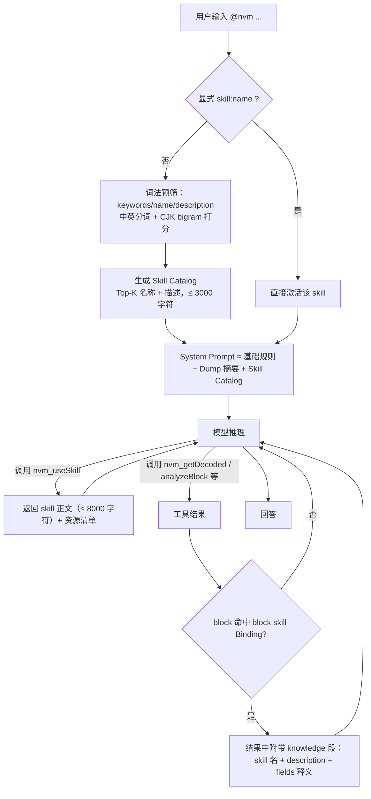
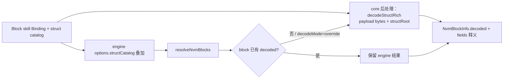

# NVM Studio Skills 设计

> 状态：**已实现**（P1–P5），并扩展了"skill 组合 + 关系分析"（见第 15 节）。
> 相关文档：`docs/nvm-ai-capabilities.md`（AI facade）、`docs/nvm-layout-providers.md`（layout/engine）、
> `shared/nvm/structRich.ts`（rich struct 解码器）。

## 1. 背景与问题

当前 `@nvm` 的上下文只有 `describeDump()` 的聚合摘要和 `nvm_*` 工具。模型**不知道**：

1. **什么时候该调哪个工具**（例如问"有多少个"时应该调 `nvm_describeDump` 而不是从截断列表里猜；
   问"某个 DTC 状态"时应先 `nvm_searchBlocks` 再 `nvm_getDecoded`）。现在这些全靠一段写死的
   `SYSTEM_PROMPT`，无法按项目/场景扩展。
2. **每个 block 在工程上代表什么**。典型失败（见 `docs/features_list.md`）：

   ```text
   @nvm 这个 mot 里面一共有多少个 reset
   → "context 里没有 reset 相关的信息 … 建议你运行 #nvmSearchBlocks reset"
   ```

   实际上 reset 计数存在某个项目自定义 block 的某个字段里。这类知识**属于项目/工程**，不属于插件，
   也不应该写进 vendor engine。

所以需要一种**外置的、纯文本的、可按需加载的**知识载体——Skill。

## 2. 目标 / 非目标

**目标**

- G1：NVM Studio 能**根据用户输入自行决定**是否、以及使用哪些 skill（无需用户手动指定，但允许手动强制）。
- G2：两类 skill：
  - **Playbook skill**（流程类）：指导 AI 在什么场景下按什么顺序调用哪些 `nvm_*` 工具、如何组织回答。
  - **Block skill**（工程知识类）：描述某一类 block 是什么、字段含义、如何解析（可选附带
    机器可读的 struct 定义，直接驱动解码器和 Data Inspector）。
- G3：**vendor-free / user-free**：core 只认识"skill"、"block 名匹配规则"、"已有的 `NvmStructDef`
  schema"，不认识任何 vendor、任何具体 block 名或业务含义。
- G4：**与插件实现弱耦合**：skill 是普通 Markdown + JSON 文件，可以被版本管理、在项目间复制，
  格式尽量兼容通用的 `SKILL.md`（Agent Skills）约定，将来换 AI 宿主也能复用。
- G5：**token 预算可控**：渐进式披露（progressive disclosure），平时只注入 skill 的名字和一句描述。

**非目标**

- 不执行 skill 里的任何代码（skill 是纯数据；需要代码的解析仍然走 T2 engine）。
- 不做向量检索 / embedding（第一版用轻量词法匹配 + 模型自选，足够且零依赖）。
- 不替代 `*.nvmlayout.json`：layout 决定"block 在哪、多长"，block skill 决定"block 里是什么"。

## 3. 核心概念

| 概念                        | 说明                                                                                              |
|-----------------------------|---------------------------------------------------------------------------------------------------|
| **Skill**                   | 一个目录，包含 `SKILL.md`（frontmatter + Markdown 正文）和可选资源文件。                              |
| **kind**                    | `playbook` 或 `block`。决定它如何被选中、注入到哪里。                                                |
| **Skill Index**             | 所有 skill 的 frontmatter 汇总（name / description / kind / keywords / appliesTo），常驻内存，体积小。 |
| **Activation**              | 某个 skill 的正文被加载进当前对话上下文。                                                          |
| **Binding**（仅 block skill） | `appliesTo` 规则与当前 dump 中 block 的匹配结果：`skill → block[]`。                                |

### 3.1 两类 skill 的区别

|            | Playbook skill                                 | Block skill                                           |
|------------|------------------------------------------------|-------------------------------------------------------|
| 回答的问题 | "遇到这类问题该怎么做？"                        | "这个 block 是什么、怎么解？"                           |
| 触发方式   | 用户意图（模型根据 description 自选 / 词法预筛） | 用户意图 **或** 工具结果触及匹配的 block（自动附带）    |
| 作用对象   | 对话流程、工具调用顺序                          | 一组 block（按名字 glob / id / 属性匹配）               |
| 可附带资源 | 示例问答、检查清单                              | `*.struct.json`（`NvmStructDef` catalog）、枚举表、样例值 |
| 影响解码   | 否                                             | 可以（提供 struct 定义 → 解码 → Data Inspector 显示）   |
| 典型作者   | 工具维护者 / 团队                              | 项目工程师（懂 DEM、懂自定义 block 的人）                |

## 4. 文件格式

### 4.1 目录结构

```text
skills/
├─ count-and-statistics/          # playbook
│  └─ SKILL.md
├─ dtc-investigation/             # playbook
│  ├─ SKILL.md
│  └─ checklist.md                # 可选资源，按需读取
├─ dem-status-data/               # block skill
│  ├─ SKILL.md
│  ├─ dem_status.struct.json      # 可选：NvmStructDef catalog
│  └─ uds_status_bits.enum.json   # 可选：枚举
└─ ecu-reset-counter/             # block skill（项目自定义 block）
│  ├─ SKILL.md
│  └─ reset.struct.json
└─ other customized skills/        
   ├─ SKILL.md
   └─ ...
```

一个 skill = 一个目录，目录名即默认 `name`。

### 4.2 `SKILL.md` frontmatter（公共字段）

```yaml
---
name: dtc-investigation          # 必填，[a-z0-9-]，全局唯一（冲突按第 5 节优先级覆盖）
kind: playbook                   # 必填，playbook | block
description: >                   # 必填，≤ 300 字符。模型据此判断是否加载——写"什么时候用"
  用户询问某个 DTC / 故障码 / 事件的状态、出现次数、冻结帧、老化计数时使用。
keywords: [DTC, 故障码, freeze frame, 冻结帧, aging, 老化]   # 可选，词法预筛用，中英都写
priority: 0                      # 可选，同分时排序，默认 0
enabled: true                    # 可选，默认 true
---
```

### 4.3 Playbook skill 额外字段与正文

```yaml
---
name: count-and-statistics
kind: playbook
description: 用户问"有多少个 / 一共几个 / 统计 / 分布"之类的计数或统计问题时使用。
keywords: [多少, 几个, count, how many, 统计, 分布, total]
tools: [nvm_describeDump, nvm_searchBlocks]   # 可选：建议使用的工具（提示，不是强制白名单）
---

## 步骤
1. 先调用 `nvm_describeDump` 拿精确聚合；**不要**从上下文的截断列表推算数量。
2. 如果用户问的是某个"业务量"（如 reset 次数）而不是 block 数量：
   先调用 `nvm_searchKnowledge` 查有没有 block skill 描述了这个量，再按 skill 指示读字段。
3. 若 `hasMore = true`，必须翻页或说明结果是部分的。

## 回答格式
- 先给数字，再给依据（哪个工具、哪个 block/字段）。
```

### 4.4 Block skill 额外字段与正文

```yaml
---
name: ecu-reset-counter
kind: block
description: ECU 复位/上电计数。用户问 reset 次数、复位原因、上电次数时使用。
keywords: [reset, 复位, 重启, power cycle, 上电次数, watchdog]
appliesTo:                       # 必填（block skill）。多个条件之间 OR；同一条件内部 OR
  blocks: ["NvM_ResetInfo*", "APP_RESET_*"]   # block 名 glob（大小写不敏感）
  ids: ["0x0123"]                              # 可选：block id
  attributes: { section: "Safe*" }             # 可选：block attribute 匹配（key → glob）
  layout: "*"                                  # 可选：只在某个 descriptor（按其 vendor/provider 字符串，opaque）下生效
struct: reset.struct.json        # 可选：NvmStructDef catalog（结构见 shared/nvm/structRich.ts）
structRoot: ResetInfo_t          # 可选：catalog 中作为 block payload 根的 struct
decodeMode: fill                 # 可选：fill（只在 block 没有 decoded 时解码，默认）| override（覆盖 engine 结果）
fields:                          # 可选：字段级短释义，自动带入工具结果和 Data Inspector
  ResetCounter:   { meaning: "累计复位次数，每次复位 +1", unit: "count" }
  LastResetReason:{ meaning: "最近一次复位原因", enum: ResetReason }
  ResetHistory[]: { meaning: "最近 8 次复位原因环形缓冲区，ResetHistoryIdx 指向最新" }
---

## 这是什么
项目自定义 block，由 `EcuM` 在 `EcuM_Init` 中更新……

## 如何回答常见问题
- "一共多少次 reset" → 读取 `ResetCounter`，不是统计 block 个数。
- "最近一次为什么 reset" → `LastResetReason`，值表见 `ResetReason` 枚举。

## 注意
- 计数器 16 bit，65535 后回绕；若 `ResetCounter < ResetHistoryIdx` 说明发生过回绕。
```

要点：

- `appliesTo` 匹配的都是 core 已有的**通用** block 属性（name / id / attributes / descriptor 标识），
  core 不认识 `NvM_ResetInfo` 这个名字，它只是 glob。
- `struct` 直接复用 `NvmStructDef` / catalog schema（`parseStructCatalog`），不发明新格式。
- `fields` 的 key 是 decoded tree 的路径（`a.b[]`，`[]` 表示数组所有元素）。

### 4.5 frontmatter 解析

只支持 YAML 的安全子集（标量、字符串、内联/块列表、一层内联 map、`>` 折叠文本），由
`shared/nvm/skills/frontmatter.ts` 自行解析，**不引入依赖、不执行任何 tag**。解析失败的 skill
被跳过并记入诊断（第 10 节）。

## 5. 发现与加载

### 5.1 搜索根目录（优先级从高到低，同名 skill 高优先级覆盖低优先级）

| # | 位置                                                                  | 作用域          | 说明                                                               |
|---|-----------------------------------------------------------------------|-----------------|--------------------------------------------------------------------|
| 1 | `nvmstudio.nvm.skillRoots` 设置中的目录                               | 用户/工作区配置 | 支持 `${workspaceFolder}`；每个目录及其 `skills/` 子目录被扫描      |
| 2 | 描述符旁：`<descriptor 所在目录>/skills/`                              | 项目            | 与 `*.nvmlayout.json` 同处的 `conf/skills/`，**项目知识跟着配置走** |
| 3 | 工作区：`<workspaceFolder>/.nvmstudio/skills/`                         | 工作区          | 可提交到项目仓库                                                   |
| 4 | **用户主目录：`<NVMSTUDIO_HOME>/skills/`**（默认 `~/nvmstudio/skills/`） | 用户            | 与 `engines/`、`conf/` 并列，见 `src/nvm/paths.ts`                   |
| 5 | 插件内置：`<extension>/skills/`                                        | 插件            | 只放**通用、vendor-free** 的 playbook（计数、搜索、单 block 分析、报告） |

> 默认目录**不放在插件安装目录或 `.vscode/` 里**，而是 NVM Studio 统一用户主目录下的
> `skills/`，与 engine / conf 的安装方式一致（详见第 14 节开放问题 Q1）。

### 5.2 加载策略

- 激活时只读 frontmatter 建 **Skill Index**；正文和资源在 activation 时才读（懒加载 + 缓存）。
- 用 `FileSystemWatcher` 监听上述目录，变更后增量重建 Index；另提供命令 **NVM: Reload Skills**。
- 打开 dump 并 `resolveNvmBlocks()` 完成后，对所有 block skill 计算 **Binding**（`skill → blockIds`），
  存入 `HexEditorRegistry`（与 blocks 同生命周期）。?还是用户请求的时候动态计算，按需计算？需要按照实际性能和需求来综合考量
- 描述符旁的 skill（#2）只在使用该描述符的 dump 激活时进入 Index。

## 6. 选择机制：插件如何根据用户输入决定用哪些 skill

采用 **"词法预筛 → 模型自选 → 按需加载"** 三段式，并辅以 **block 自动附带** 和 **用户显式指定**。



### 6.1 词法预筛（插件侧，确定性，零 token）

- 对用户 prompt 做分词：ASCII 单词小写化 + 中文 bigram。
- 对每个 skill 的 `name`、`keywords`（权重高）、`description`（权重低）打分。
- **始终**列出：所有内置 playbook 中 `priority >= 10` 的（如 `count-and-statistics`）。
- 取 Top-K（默认 K=12，`nvmstudio.nvm.skills.catalogSize`）进入 Catalog；总 skill 数 ≤ K 时全部列出，
  不做预筛。预筛只是为了控制 token，**最终决定权在模型**。

### 6.2 模型自选（`nvm_useSkill`）

System prompt 中追加：

```text
SKILLS: The following skills contain project/domain knowledge. If a skill's description
matches the user's request, call nvm_useSkill(name) BEFORE answering and follow it.
Prefer skill knowledge over guessing. If no skill matches, call nvm_searchKnowledge(query)
once before concluding the information is not in the dump.
- count-and-statistics (playbook): 用户问"有多少个 / 统计"…
- ecu-reset-counter (block, 1 matching block): ECU 复位/上电计数…
```

- block skill 在 Catalog 中带上"当前 dump 中命中 N 个 block"，命中 0 的 block skill **不进 Catalog**
  （但仍可被 `nvm_searchKnowledge` 检索到，以便回答"为什么找不到"）。
- 同一轮对话里已激活的 skill 不重复注入。

### 6.3 Block 自动附带（解决"AI 不知道 block 含义"）

当 `nvm_analyzeBlock` / `nvm_getDecoded` / `nvm_searchBlocks` 的结果涉及命中 Binding 的 block 时，
facade 在结果末尾附带：

```text
knowledge:
  skill: ecu-reset-counter  (call nvm_useSkill for full guidance)
  ResetCounter = 42   — 累计复位次数，每次复位 +1 [count]
  LastResetReason = 3 (WATCHDOG) — 最近一次复位原因
```

每次工具结果附带的 knowledge ≤ 1500 字符；`searchBlocks` 只附 skill 名不附字段。

### 6.4 用户显式指定

- 在 prompt 中写 `skill:<name>`（可多个），强制激活，跳过预筛。
- 静态声明的 chat 子命令：`@nvm /skills` 列出当前可用 skill 及命中情况；
  `@nvm /noskills ...` 本次禁用自动 skill（排障用）。
- 设置 `nvmstudio.nvm.skills.mode`：`auto`（默认）| `manual`（只认显式）| `off`。

## 7. Block skill 与解码集成

Block skill 的 `struct` 不只是给 AI 看，还要**真正参与解码**，让 Data Inspector、Blocks 表、Report、
AI 工具看到同一份结构化结果。



1. **Engine 叠加（T2）**：engine 已支持 `options.structCatalog`（见
   `engines/vector-fee-v3/src/feeV3Structs.ts`）。core 把所有 binding 到该 dump 的 block skill catalog
   合并后作为 overlay 传入，engine 可以按名字用到这些结构——core 不需要知道 engine 怎么用它。
2. **Core 后处理（T0/T1，以及 engine 未解码的 block）**：`resolveNvmBlocks()` 之后执行
   `applyBlockSkills(blocks, bindings)`：对 `decoded` 为空（或 `decodeMode: override`）的命中 block，
   用 `decodeStructRich(payload, catalog.structs[structRoot], …)` 解码。该过程是 total 的，不抛异常。
3. **字段释义**：`fields` 中的 `meaning` / `unit` 合并进 decoded 节点的一个新可选属性 `doc`，
   通过 `shared/protocol.ts` 已有的 `SetNvmBlocks` 发给 webview；`dataInspector.tsx` 的
   `NvmByteExplain` 显示字段释义和来源 skill 名。
4. **冲突**：多个 block skill 命中同一 block 时，按 (搜索根优先级, `priority`, name) 取第一个做解码；
   所有命中 skill 的释义都保留，供 AI 参考。冲突写入诊断。

## 8. AI facade 与工具改动

遵循 `docs/nvm-ai-capabilities.md` 的规则：能力加在 `NvmCapabilities`，工具层只做校验和渲染，
**所有上限在 facade 内**。

| Facade 方法                                        | LM tool                 | 输入                | 返回                                               | 上限                                    |
|----------------------------------------------------|-------------------------|---------------------|----------------------------------------------------|-----------------------------------------|
| `listSkills`                                       | `nvm_listSkills`        | `{ kind?, query? }` | `Page<SkillSummary>`（含 block 命中数）              | ≤ 100                                   |
| `useSkill`                                         | `nvm_useSkill`          | `{ name }`          | `{ name, kind, body, resources[], boundBlocks[] }` | body ≤ 8000 字符；boundBlocks ≤ 50       |
| `readSkillResource`                                | `nvm_readSkillResource` | `{ name, path }`    | 资源文本                                           | ≤ 8000 字符；只允许 skill 目录内相对路径 |
| `searchKnowledge`                                  | `nvm_searchKnowledge`   | `{ query, limit? }` | 命中的 skill 段落 + 关联 block                     | ≤ 10 条，每条 ≤ 600 字符                 |
| （改）`analyzeBlock` / `getDecoded` / `searchBlocks` | 现有                    | 不变                | 增加可选 `knowledge` 段                            | ≤ 1500 字符                             |

`chatParticipant.ts` 改动：

- `SYSTEM_PROMPT` 拆成：基础规则（保留）+ Skill Catalog（动态）+ 已显式激活 skill 正文。
- `MAX_ROUNDS` 从 5 调到 8（加载 skill 本身会消耗一轮），可由设置覆盖。
- `progress` 中提示"Using skill: xxx"，让用户看到 AI 用了哪个 skill（可解释性）。

`package.json`：声明上述 4 个 `languageModelTools`、chat 子命令 `skills` / `noskills`，以及设置：

| 设置                                | 默认   | 说明                               |
|-------------------------------------|--------|------------------------------------|
| `nvmstudio.nvm.skills.mode`         | `auto` | `auto` / `manual` / `off`          |
| `nvmstudio.nvm.skillRoots`          | `[]`   | 额外的 skill 搜索目录              |
| `nvmstudio.nvm.skills.catalogSize`  | `12`   | 注入 Catalog 的最大 skill 数       |
| `nvmstudio.nvm.skills.applyStructs` | `true` | block skill 的 struct 是否参与解码 |

## 9. 安全与信任

- Skill 是**纯数据**（Markdown + JSON），不执行代码，struct 中的表达式走已有的 `expr.ts` 白名单求值器。
- 但 skill 正文会进入 prompt，存在 prompt injection 风险：
  - 工作区内的 skill（#2、#3）只在 **Workspace Trust** 下加载；不受信任时只加载用户主目录与内置 skill，
    并在 `/skills` 输出中说明。
  - skill 正文永远以 "reference material" 形式注入，不能修改基础规则；`nvm_createNote` 的确认流程不受
    skill 影响（skill 不能绕过写操作确认）。
- `readSkillResource` 做路径规范化，拒绝 `..` 和绝对路径，只能读 skill 自己目录内的文件。
- 所有大小上限在 facade 内强制。

## 10. UI 与可观测性

- **NVM Studio 视图**新增 `Skills` 节点：按 kind 分组，block skill 下展开显示当前 dump 中命中的 block，
  点击跳转；解析失败/冲突的 skill 带警告图标。
- 命令：
  - **NVM: New Skill…**：选择 kind 与目标目录（默认用户主目录），生成模板。
  - **NVM: Reload Skills**
  - **NVM: Show Skill Diagnostics**：输出到 NVM log（frontmatter 错误、struct 解析错误、重名覆盖、
    binding 冲突、未命中任何 block 的 block skill）。
- `capabilityCatalog.ts` 增加对应条目（AI tools + Layout & configuration 分组）。
- 本地化字符串走 `package.nls.json`。

## 11. 模块划分

```text
shared/nvm/skills/                 # node + browser 安全，纯函数，可单测
  types.ts           SkillMeta / SkillKind / AppliesTo / SkillIndex / Binding
  frontmatter.ts     安全 YAML 子集解析
  match.ts           glob 匹配 + computeBindings(index, blocks)
  rank.ts            分词（ASCII + CJK bigram）与预筛打分
  apply.ts           applyBlockSkills(blocks, bindings, catalogs) → decoded + doc
  index.ts           barrel（并加入 shared/nvm/index.ts）

src/nvm/skills/                    # 依赖 vscode
  skillRoots.ts      计算搜索根（设置、描述符旁、工作区、用户主目录、内置）
  skillRegistry.ts   扫描、懒加载正文、watcher、诊断、trust 过滤
  skillCommands.ts   New / Reload / Diagnostics
  skillsTree.ts      NVM Studio 树节点

src/nvm/paths.ts                   + nvmStudioSkillsUri()
src/nvm/ai/nvmCapabilities.ts      + listSkills / useSkill / readSkillResource / searchKnowledge，knowledge 附带
src/nvm/ai/lmTools.ts              + 4 个工具
src/nvm/ai/chatParticipant.ts      Catalog 注入、显式 skill:name、/skills /noskills
src/hexEditorProvider.ts           resolveNvmBlocks 前后：structCatalog overlay + applyBlockSkills
shared/protocol.ts                 decoded 节点可选 doc 字段
media/editor/dataInspector.tsx     显示字段释义
skills/                            内置通用 playbook（4 个左右）
```

vendor-free 检查：`shared/nvm/skills/*` 与 `src/nvm/skills/*` 中不得出现任何 vendor 名或具体 block 名；
内置 skill 也只写通用流程。

## 12. 实施阶段

| 阶段              | 内容                                                                                                                    | 验收                                                                                        |
|-------------------|-------------------------------------------------------------------------------------------------------------------------|---------------------------------------------------------------------------------------------|
| **P1 基础**       | types / frontmatter / registry / roots / `nvmStudioSkillsUri` / Reload & Diagnostics 命令                               | 放入几个 skill，诊断输出正确识别；坏 frontmatter 被跳过                                       |
| **P2 Playbook**   | rank 预筛、Catalog 注入、`nvm_listSkills` / `nvm_useSkill` / `nvm_readSkillResource`、`skill:name`、`/skills`、内置 playbook | 问"有多少个 X" 时模型先加载 `count-and-statistics` 再调 `nvm_describeDump`                  |
| **P3 Block 知识** | match / Binding、`nvm_searchKnowledge`、工具结果 knowledge 附带                                                           | 用 demo dump + 一个自定义 reset block skill，问"一共多少个 reset"能定位到字段并给出数值      |
| **P4 Block 解码** | `applyBlockSkills`、engine `structCatalog` overlay、protocol `doc`、Data Inspector 释义                                    | 点选该 block 字节，Inspector 显示解码值和释义；engine 已解码的 block 在 `fill` 模式下不被覆盖 |
| **P5 UI**         | Skills 树、New Skill 模板、capability catalog、nls、文档                                                                    | 可在 UI 内创建、查看、跳转                                                                    |

每个阶段结束执行：`npx tsc --noEmit`、`npm run lint`、`npm run compile`，并在 Extension Development Host
中手动验证。

## 13. 测试

- 单测（加入 `src/test/index.ts` 的 `fileImports`）：
  - `nvmSkillsFrontmatter.test.ts`：合法/非法 frontmatter、折叠文本、内联 map。
  - `nvmSkillsMatch.test.ts`：glob、id、attributes、layout 条件；OR 语义；冲突排序。
  - `nvmSkillsRank.test.ts`：中英混合 prompt 的预筛排序（如"有多少个reset" 命中 `ecu-reset-counter` 与
    `count-and-statistics`）。
  - `nvmSkillsApply.test.ts`：fill / override、`fields` 路径（含 `[]`）合并为 `doc`。
- facade 测试：`useSkill` / `readSkillResource` 的上限与路径穿越拒绝。
- 手动：第 1 节中的 reset 问题、DEM 状态问题作为回归场景写入 `docs/nvm-context.md` 的 scenario prompts。

## 14. 开放问题（请 review 时确认）

- **Q1 默认目录**：需求里"skills 的默认目录不是在……"这句话没写完。本草案默认放在
  `<NVMSTUDIO_HOME>/skills/`（即 `~/nvmstudio/skills/`，与 engines/conf 并列），并支持描述符旁
  `conf/skills/` 和工作区 `.nvmstudio/skills/`。请确认你想要的默认位置。
- **Q2 兼容 Copilot 原生 Agent Skills**：是否同时把 playbook 暴露给 Copilot 原生的 skill 机制
  （如 `.github/skills/`）？本草案只在 `@nvm` 内部使用，避免与宿主行为耦合。
- **Q3 block skill 与 engine 的边界**：`decodeMode: override` 是否允许？允许可修正 engine 的错误解码，
  但可能让同一 block 在不同机器上结果不同（取决于本地 skill）。
- **Q4 frontmatter 解析**：自写安全子集解析（零依赖，草案方案）还是引入 `yaml` 包？
- **Q5 知识回写**：是否需要 "把这次 AI 的结论保存为 block skill" 的命令（类似 `createNote` 的确认流程）？
  建议放到 P5 之后。

## 15. 实现说明（2026-11-17）

### 15.1 模块（遵循 SRP，每个文件单一职责）

```text
shared/nvm/skills/          纯函数内核（node + browser）
  types.ts        SkillMeta / AppliesTo / SkillRule / SkillRelation / Binding
  yamlFlow.ts     YAML 子集：flow 集合 + 标量        frontmatter.ts  YAML 子集：块语法 + frontmatter 拆分
  meta.ts         frontmatter → 校验后的 SkillMeta    match.ts        glob / binding / 冲突优先级
  rank.ts         分词（ASCII + CJK bigram）、预筛、skill:name 解析
  paths.ts        decoded 路径（a.b / arr[2].x / arr[]）  predicate.ts 白名单表达式求值器（比较/逻辑/位运算/聚合）
  apply.ts        struct 解码（fill/override）+ 字段 doc   knowledge.ts knowledge 附带段 + 段落检索
  rules.ts        rules / relations 评估 → findings
shared/nvm/analysis/        通用关系分析（不依赖 skill）
  blockScope.ts   block → 表达式作用域（self/other、$sequence、$versions、$attr.<key>…）
  versions.ts     identity 分组、最新版本、decoded 差异       timeline.ts 写入时序、窗口、写入相关性
src/nvm/skills/             vscode 侧
  skillRoots.ts  skillLoader.ts  skillRegistry.ts  skillDecodePass.ts  skillsTree.ts  skillCommands.ts  skillTemplates.ts
src/nvm/ai/
  capabilityTypes.ts / activeDump.ts       共享类型、活动 dump 访问
  skillCapabilities.ts / analysisCapabilities.ts   两个子 facade，由 NvmCapabilities 组合（caps.skills / caps.analysis）
  lmToolKit.ts / lmSkillTools.ts / lmAnalysisTools.ts   工具注册按领域拆分
  chatPrompt.ts                            system prompt 组装（基础规则 + Catalog + 显式 skill）
skills/                     内置通用 playbook（vendor-free）
docs/features/skill-templates/   待填写的 block / 组合 playbook 模板（不会自动加载）
```

### 15.2 第 5.2 节问题的决定：Binding 按需计算 + 记忆化

Binding 不在打开 dump 时全量计算，而是在消费方（解码 pass、AI 工具、Skills 树）需要时计算，并以
`(blocks 数组, index generation)` 为键缓存在 `WeakMap`。唯一的"打开即计算"发生在解码 pass——且只在存在
block skill 时；没有 block skill 时零开销。

### 15.3 开放问题的实现选择

- **Q1**：默认用户目录 `~/nvmstudio/skills/`（`$NVMSTUDIO_HOME/skills`），另支持描述符旁 `skills/`、
  `conf/skills/`、`<layoutRoot>/skills/`，工作区 `.nvmstudio/skills/`，设置 `nvmstudio.nvm.skillRoots`。
- **Q2**：只在 `@nvm` / `nvm_*` 工具内使用，未接入宿主原生 skill 机制。
- **Q3**（2026-11-18 修订）：**layout 配置为准**。`decodeMode` 默认 `fill`（覆盖关闭），skill 的 `struct` 只兜底配置未解码的 block；
  用户可在单个 skill 中显式写 `decodeMode: override` 打开覆盖（日志警告）。skill catalog **不再**作为 overlay 传给 engine。详见 15.8。
- **Q4**：自写安全子集解析器（零依赖），错误带行号进入诊断。
- **Q5**：未实现（建议后续用 `createNote` 同款确认流程）。

### 15.4 扩展：skill 组合与深层关系分析

为支持"通过复杂的 skill 组合排查时序、写入关系、逻辑关系、业务关系"，在设计稿基础上增加：

1. **组合（`uses`）**：任一 skill 可声明 `uses: [a, b]`。`nvm_useSkill` 返回被组合 skill 的摘要，
   提示模型继续加载；`nvm_checkRules({ skills: [playbook] })` 会连带评估被组合 skill 的规则。
2. **声明式约束**（block skill frontmatter，纯数据，经白名单求值器执行）：
   - `rules`：单 block 不变量，如 `ResetHistoryIdx < count(ResetHistory[])`；`scope: latest | all`。
   - `relations`：跨 block 关系，`kind` 为
     `order`（写入先后，`expect: before|after|together`、`within`）、
     `cowrite`（每次写入是否伴随另一类 block）、
     `value`（`self.X == other.Y` 等跨 block 逻辑）、
     `presence`（必须存在/不存在）、
     `reference`（字段值指向另一个 block 的 id/identity/offset）。
     每条可带 `meaning`（业务含义），随 finding 一起交给 AI。
3. **通用关系分析工具**（不依赖任何 skill，只用通用 `sequence` / `identity` / `isLatest` / decoded 树）：

| LM tool | 回答的问题 |
|---------|-----------|
| `nvm_timeline` | 写入顺序；X 前后写了什么（`around`/`window`）；最近写入 |
| `nvm_blockHistory` | 一个逻辑 block 的所有版本，以及每次写入改了哪些字段（Δ） |
| `nvm_correlateWrites` | A 写入时 B 是否伴随、谁先谁后、距离分布、孤立写入 |
| `nvm_queryFields` | 一个字段在多个 block 上的值表；`where` 表达式筛选 |
| `nvm_evaluate` | 任意表达式按 block / block 对评估（`self.*` / `other.*`） |
| `nvm_checkRules` | 评估所有 skill 声明的 rules / relations，给出证据 |

4. **内置组合 playbook**：`write-timeline`（时序）、`cross-block-consistency`（逻辑/一致性）、
   `block-deep-dive`（单 block）、`count-and-statistics`（计数，pinned）、
   `root-cause-investigation`（`uses` 前三者的多步根因排查流程）。

### 15.5 表达式语法（rules / relations / nvm_evaluate / nvm_queryFields.where）

- 标识符：decoded 字段路径（`Counter`、`a.b`、`arr[2].x`、`arr[]`），`self.`/`other.` 前缀；
  元数据 `$sequence $offset $length $isLatest $id $name $identity $versions $group $attr.<key>`。
- 运算：`== != < <= > >=`、`&& || !`（也可写 `and or not`）、`+ - * / %`、`& | ^ ~ << >>`。
- 函数：`exists(path) count(path) sum(path) any(path) all(path) distinct(path)`、
  `min max abs bit(value, n) contains(text, sub)`。
- 未知字段报错（规则记为 "not evaluable"），`&&`/`||` 短路，从不执行任意代码。

### 15.6 设置与命令

设置：`nvmstudio.nvm.skills.mode`、`nvmstudio.nvm.skillRoots`、`nvmstudio.nvm.skills.catalogSize`、
`nvmstudio.nvm.skills.applyStructs`、`nvmstudio.nvm.chat.maxToolRounds`（默认 8）。
命令：NVM: New Skill… / Reload Skills / Show Skill Diagnostics / Check Skill Rules & Relations；
NVM Studio 侧栏新增 **Skills** 视图；`@nvm /skills`、`@nvm /noskills`、`skill:<name>`。

### 15.7 验证

`npx tsc --noEmit`、eslint、`node .esbuild.config.js`、`npm run nvmcli:build` 通过；
`src/test/nvmSkills.test.ts`、`src/test/nvmAnalysis.test.ts`（24 例）已用 mocha 直接运行通过。
尚需在 Extension Development Host 中用真实 dump + 项目 block skill 做手动验证（第 13 节回归场景）。

### 15.8 修订（2026-11-18）：配置为准、按值路由文档、标签比较

依据 ARS620CN15 demo 与参考实现（`adas_embed_mon`）的核对结果修订：

1. **layout 以配置为准**：`*.nvmlayout.json`（engine / C 头文件 / inline catalog）解码过的 block，skill 不再解码或覆盖；
   skill `struct` 只兜底配置未覆盖的 block，并在日志中报告 "config wins"。移除了 skill catalog → engine overlay。
   `decodeMode: override` 保留为**显式开启**的选项（默认关闭），开启后替换配置的解码并在日志中警告。
5. **`params`**：skill 可声明命名常量（如 `NVM_BLOCKS: 3`），在其 rules / relations 中直接引用，
   把"随项目变化的配置值"从表达式里分离出来。
   block skill 通常**不需要**写 `struct`，只写 `fields` / `valueDocs` / `rules` / `relations`。
2. **`valueDocs`（按值路由文档）**：一个 block skill 可以把某字段的每个取值（按枚举名或数值 glob，先具体后宽泛）
   路由到 skill 目录内的文档或 `skill:<name>`。工具结果的 `knowledge:` 段会直接写出"当前值由哪份文档解释"，
   `nvm_useSkill` 列出完整路由表。这样"150+ 种复位原因"只需一个 skill + 若干分类文档，而不是 150 个 skill；
   只有需要独立排查流程的类别（如异常 → map 文件）才单独做 playbook。
3. **表达式新增**：`label(path)`（枚举名 / 值文本）、`glob(text, pattern)`、`trailingNumber(text)`（从 block 名取槽位号）；
   display 格式化后的字符串值（如 `"0x0F - 15"`）在比较时自动回退为原始数值。
4. **knowledge 段**：数组元素共享同一释义时合并为一行。

参考示例 `docs/features/skill-templates/ecu-reset-counter/`（block skill + `reasons/*.md`）已在两份 demo dump 上
验证：绑定 3 条记录、94 个字段释义、21 条规则 / 关系检查全部通过。核对过程中修正了 demo 配置：
`FS_SafeSection_Prv.h` 换成参考实现的值（记录长度 144 B，CRC32 与全部记录一致；原估算值为 164 B）、
`Shared` 联合体补全 1..9 号成员且去掉错误的 `default: Mcu`、`Nvm_SafeSection_Index` 改绑为单个 `u8` 索引。
