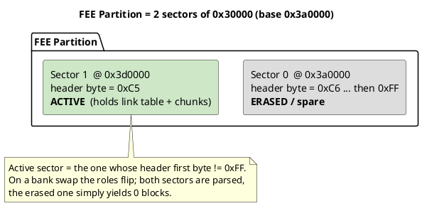
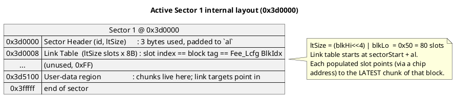
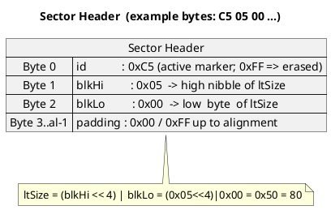
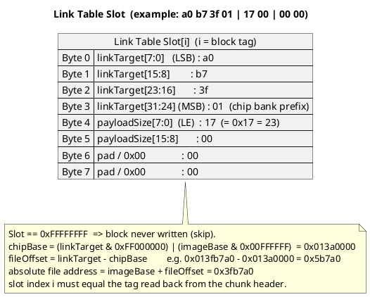
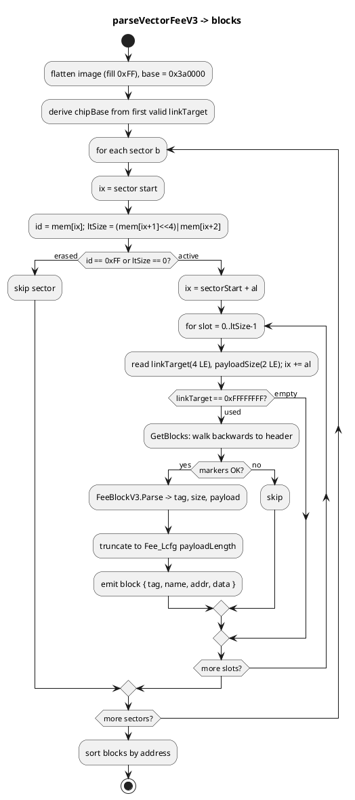
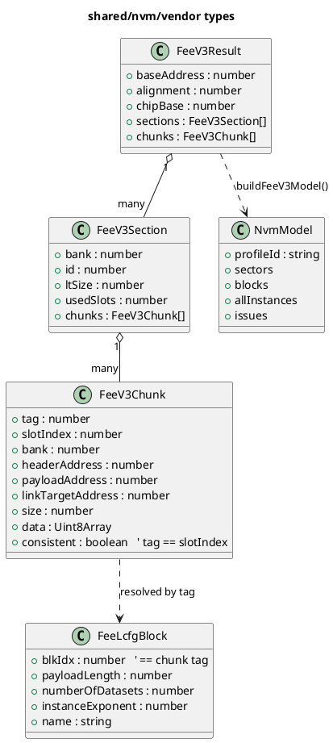

# Vector MICROSAR FEE V3 — On-Flash Layout (UML)
> Please note that the following results are not guaranteed to be 100% accurate, as they are all generated by AI.
> Verified against `NVM_test.mot` + `Fee_Lcfg.c` and ported from the C# reference
> `NvmVector3.cs`. See `docs/nvm-context.md` §7 for the prose summary.
> Concrete values below are from the real demo image (base `0x3a0000`, alignment 8).

Legend: **LE** = little-endian, `al` = address alignment (= 8 bytes here),
`0x0A` = payload marker, `0xFF` = erased flash.

---

## 1. Partition overview — two sectors, one active



---

## 2. Active sector — internal regions



---

## 3. Sector header (3 bytes used)



---

## 4. Link-table slot (8 bytes) — one per block index



---

## 5. Chunk byte layout (walk BACKWARDS from linkTarget)

Real example: block **tag 20 = `FeeNvMBlockDescriptor_FBLSoftVer_F170`**, payload `"V1.17"`.
`linkTarget = 0x013fb7a0`, `payloadSize = 23`, net length (Fee_Lcfg) = 20.

```plantuml
@startuml FEE_V3_Chunk
skinparam backgroundColor #FFFFFF
skinparam defaultFontName Consolas
skinparam shadowing false
title FEE Chunk (tag 20, "V1.17") — addresses absolute

map "Chunk (tag 20, \"V1.17\") @ 0x3fb770 .. 0x3fb7a8" as C {
  0x3fb770 => Header page (8B)      : tag(2) datasetIdx(1) mgmtType(1) pld(2 LE) aln(2)
  0x3fb778 => Alignment pad (8B)    : FF FF FF FF FF FF FF FF
  0x3fb780 => Start marker          : 0x0A
  0x3fb781 => Payload (pld = 23B)   : NvM data (net 20) + optional MAC/CRC + padding
  0x3fb798 => Chunk trailer (8B)    : 0A 00 0C 00 0A 00 04 00 (Fee_InternalFillInstanceBufferTrailerPage)
  0x3fb7a0 => Next-chunk link (8B)  : linkTarget points HERE (used to locate the chunk)
}

map "Header page detail (8 bytes)" as HD {
  Byte 0 => tag[7:0]  (LE)  : 14  -> 0x0014 = 20  (== FeeBlockId slot)
  Byte 1 => tag[15:8]       : 00
  Byte 2 => dataset idx     : 00
  Byte 3 => mgmt type       : 01  (0x01 NATIVE, 0x10 DATASET, redundant = ...)
  Byte 4 => pld[7:0]  (LE)  : 17  -> 0x17 = 23 (stored payload span)
  Byte 5 => pld[15:8]       : 00
  Byte 6 => aln[7:0]        : 00
  Byte 7 => aln[15:8]       : 00
}

C::0x3fb770 -right-> HD : bit/byte detail

note bottom of C
  NvM "net" length comes from Fee_Lcfg.c (20). The header `pld` and the link-table
  payloadSize (23) are the FULL stored size = NvM data + optional MAC/CMAC/CRC +
  padding. What sits between net and pld depends on the block config (a 16-byte
  CMAC, a CRC, or nothing). An 8-byte chunk trailer + 8-byte next-chunk link follow;
  the link-table slot points at that next-chunk-link field (the chunk TAIL).

  IMPORTANT: Fee_Lcfg.c payload length already bundles the integrity bytes
  (data + MAC). To recover the *true* business-data length and the MAC size
  separately, declare `NvM_Cfg.c` as the `nvmCfg` source — `NvMNvBlockLength` is
  the data length and `NvMacSize` the CMAC/CRC size. Example
  `Nvm_SafeSection_Index`: stored 23 = 1 (data) + 16 (CMAC) + 6 (padding), whereas
  Fee_Lcfg alone reports payload length 17 (= data + MAC), hiding the split.
end note
@enduml
```

### Business-data vs. stored payload (`NvM_Cfg.c`)

`Fee_Lcfg.c` reports only the *stored* net length (business data **plus** the
appended CMAC/CRC). The generated `NvM_BlockDescriptorTable_at[]` in `NvM_Cfg.c`
is the authoritative split:

| `NvM_Cfg.c` field  | Meaning                                    |
|--------------------|--------------------------------------------|
| `NvMNvBlockLength` | true business-data length (struct-decoded) |
| `NvMacSize`        | trailing CMAC/CRC size (0 = none)          |

When the descriptor declares `"sources": { "nvmCfg": "NvM_Cfg.c" }`, the engine
renders three distinct payload regions — **payload** (`NvMNvBlockLength`), **MAC /
CRC** (`NvMacSize`), **padding** (remainder) — and decodes bound structs against
the business data only, never into the CMAC. Without `nvmCfg` it falls back to the
Fee_Lcfg net length plus one combined integrity/padding region (legacy behaviour).


### Backward-resolution arithmetic (from `SectionV3.GetBlocks`)

```
la  = linkTarget - chipBase          ; 0x5b7a0            (abs 0x3fb7a0)
la -= al                             ; 0x5b798  expect mem[la]==0x0A  (chunk trailer start)
la -= payloadSize + 1                ; 0x5b780  expect mem[la]==0x0A  (start marker)
la -= al                             ; 0x5b778
la -= (al == 8 ? 8 : 0)              ; 0x5b770  -> chunk header
```

> The block builder renders the full on-flash footprint: header → FF pad + start
> marker → NvM data (net) → MAC/CRC + padding (pld − net) → 8-byte trailer →
> 8-byte next-chunk link. When `NvM_Cfg.c` is declared as the `nvmCfg` source, the
> "NvM data" and "MAC/CRC" spans are split exactly (`NvMNvBlockLength` /
> `NvMacSize`) with a separate padding region. `mgmtType` and `datasetIndex` are
> surfaced in the Data Inspector (`raw.mgmtType` / `raw.datasetIndex`).

---

## 6. Parse algorithm (activity)



---

## 7. Parser type model (class)



---

## 8. How this differs from `help.md`

| Aspect       | help.md guess                                                       | Verified reality                              |
|--------------|---------------------------------------------------------------------|-----------------------------------------------|
| Container    | V2 sequential scan                                                  | **V3 link-table driven**                      |
| Alignment    | 256                                                                 | **8**                                         |
| Link target  | "本页首地址" (start of page)                                        | points **past** the chunk; walk **backwards** |
| Tag location | separate "tag page" bytes 0-1                                       | first 2 bytes (LE) of the **header page**     |
| Right about  | link table exists; tag = LUT index; ~0x50 total; 8-byte granularity | ✅                                             |
