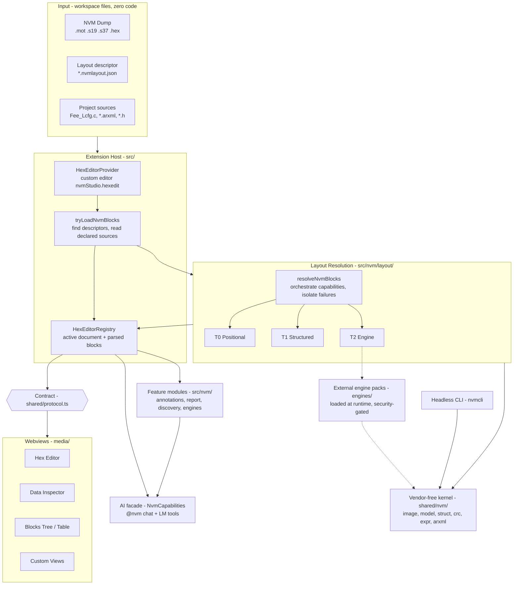
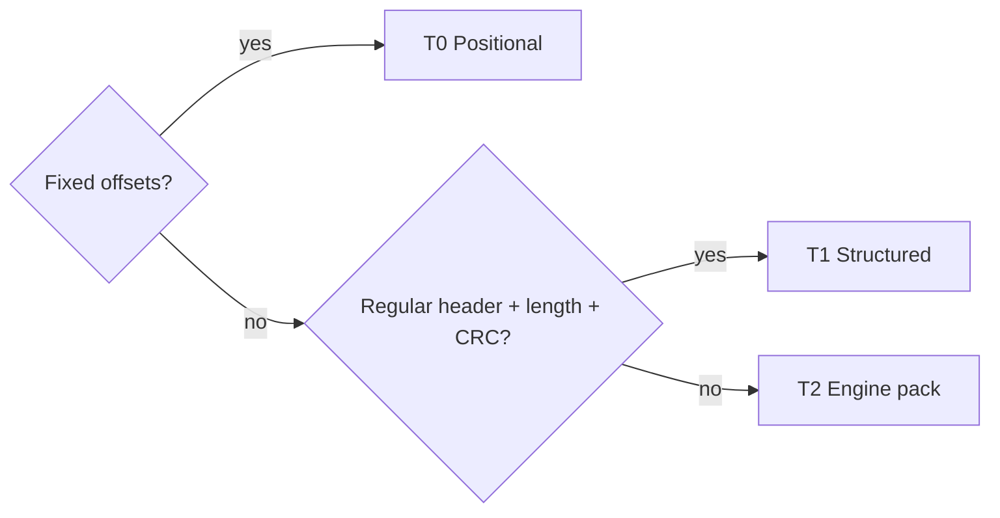
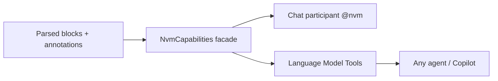
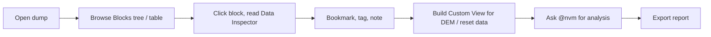

# NVM Studio

### A Config-Driven, Vendor-Agnostic, AI-Ready Platform for AUTOSAR NVM Dump Analysis

Built on top of the VS Code Hex Editor (custom editor + webviews)

> **Speaker notes:** One sentence to remember — *the tool knows nothing about any vendor; all vendor knowledge lives in configuration and pluggable packs.*

---

## Agenda

1. The problem
2. The core idea
3. Design principles
4. Software architecture
5. Key mechanisms (capabilities, tiers, engines, views, AI)
6. How to use it
7. How to extend it to a new vendor
8. Summary & Q&A

---

## 1. The Problem

- ECUs persist runtime data (DEM events, reset reasons, calibration, safety records) in **NVM / FEE / EA** flash.
- When a field issue happens, engineers receive a **raw dump** (`.mot` / `.s19` / `.hex`) and must answer: *what is in this block, is it valid, what happened before the reset?*
- Every vendor (Vector, EB, in-house …) uses a **different, often algorithmic** layout:
  - link tables, chunk headers/trailers, redundant / dataset / native blocks
  - optional CRC or CMAC, garbage collection, sector rotation
- Existing analyzers **hard-code each vendor and each project** → every new ECU means new code, new release, new tool.

> **Speaker notes:** The pain is not reading bytes — it is the N × M explosion of vendors × projects baked into tools.

---

## 2. The Core Idea

> **Separate the *tool* from the *knowledge*.**

| The tool (NVM Studio) knows …                      | The configuration / packs know …                  |
|----------------------------------------------------|---------------------------------------------------|
| How to load a memory image                         | Which vendor format the dump uses                 |
| How to render blocks, fields, colors               | Where blocks are and how they are chained         |
| How to decode a struct, check a CRC, follow a link | Which struct / CRC / enum applies to which block  |
| How to bookmark, tag, note, report                 | Which project files (`.arxml`, `.c`, `.h`) matter |
| How to expose everything to AI                     | Business meaning of each block (DEM, reset, …)    |

- The core speaks only in **capabilities**: `image` · `symbols` · `layout` · `struct` · `annotations`
- It never names a vendor, a file format, or a project.

---

## 3. Three Design Principles

| # | Principle           | What it means in practice                                                                                                  |
|---|---------------------|----------------------------------------------------------------------------------------------------------------------------|
| 1 | **Vendor-agnostic** | No vendor or format name in `shared/` or `src/nvm/layout/` core. New vendor = a descriptor, an adapter, or an engine pack. |
| 2 | **Config-driven**   | Nothing renders automatically. No matching descriptor → it is just a plain hex editor. Zero side effects.                  |
| 3 | **AI-native**       | One capability facade feeds both chat (`@nvm`) and Language Model Tools — same semantics, no second adapter.               |

Additional goal: **user-free** — users build their own views, notes, and reports without touching plugin code.

---

## 4. Architecture Overview



---

## 4.1 Layer Responsibilities

| Layer             | Responsibility                                                                    | Key code                                               |
|-------------------|-----------------------------------------------------------------------------------|--------------------------------------------------------|
| Input             | User drops a dump + one JSON descriptor; descriptor declares the sources it needs | `*.nvmlayout.json`                                     |
| Extension Host    | Owns the document, discovers descriptors, reads declared source files             | `src/hexEditorProvider.ts`, `src/hexEditorRegistry.ts` |
| Layout Resolution | Runs registered providers by capability; first match wins; failures isolated      | `src/nvm/layout/`                                      |
| Engine packs      | Algorithmic vendor formats as separate, runtime-loaded packs                      | `engines/vector-fee-v3/`                               |
| Kernel            | No VS Code dependency — shared by Node host, browser webview and CLI              | `shared/nvm/`                                          |
| Contract          | The **only** host ↔ webview communication surface                                 | `shared/protocol.ts`                                   |
| Views             | Hex grid, Data Inspector, Blocks tree/table, Custom Views                         | `media/`                                               |
| Features          | Bookmarks / tags / notes, reports, dependency discovery, engine management        | `src/nvm/*`                                            |
| AI                | One facade → `@nvm` chat + 10 Language Model Tools                                | `src/nvm/ai/nvmCapabilities.ts`                        |
| CLI               | Validate the parsing chain without launching the editor                           | `node dist/nvmcli.js`                                  |

---

## 5. Key Mechanism: Capabilities

The core does not ask *"is this Vector?"* — it asks *"who can provide this capability?"*

| Capability    | Question it answers                        | Example providers (pluggable)                   |
|---------------|--------------------------------------------|-------------------------------------------------|
| `image`       | What bytes live at which absolute address? | S-record / Intel HEX image loader               |
| `symbols`     | What is the name of block id *N*?          | ARXML catalog import, generic `#define` scraper |
| `layout`      | Where are the blocks and their fields?     | T0 / T1 / T2 layout providers                   |
| `struct`      | What does the payload mean?                | C-struct / rich struct decoders, enums, compu   |
| `annotations` | What did humans say about it?              | Bookmarks, tags, notes (sidecar or workspace)   |

- Providers implement `detect(ctx)` / `parse(ctx)`; a throwing provider never breaks the others.

---

## 5.1 Key Mechanism: Three Tiers of Layout Power

> Pick the **lowest** tier that fits — escalate only when needed.

| Tier | Name       | Described by                                                                      | Fits                                                          | Code needed |
|------|------------|-----------------------------------------------------------------------------------|---------------------------------------------------------------|-------------|
| T0   | Positional | Static `blocks` with offsets / lengths                                            | Fixed tables, sequential or dual-ended layouts                | None        |
| T1   | Structured | Declarative `profile` (header, length, CRC, iteration) — the core walks the image | Regular record streams                                        | None        |
| T2   | Engine     | `engine` / `engineScript` — arbitrary JS via a stable SDK                         | Log-structured, linked, GC-based formats (e.g. Vector FEE V3) | Engine pack |



---

## 5.2 Key Mechanism: External Engines & Security

- Engine packs (`engine.json` + `createEngine(sdk)`) live **outside** the extension bundle.
- The core injects a **versioned, vendor-neutral SDK** (image access, CRC, struct decode, `#define` parsing …).
- Because an engine executes workspace JavaScript, it passes **four gates**:

| Gate                                 | Purpose                                    |
|--------------------------------------|--------------------------------------------|
| Workspace Trust                      | Untrusted folders never run engines        |
| `nvmstudio.nvm.allowExternalEngines` | Master switch for locked-down environments |
| Per-file confirmation                | User explicitly approves each engine once  |
| Desktop host only                    | Never runs in the web build                |

- Distribution: **NVM: Install Engine…**, **Install Vendor Pack (Engine + Configs) from URL…**, **Manage Engines…**

---

## 5.3 Key Mechanism: Rendering & Views

- **Selection-driven coloring** — click a byte → only that unit's fields are colored (header, payload, CRC, trailer …). Keeps large dumps readable.
- **Data Inspector** explains the selected byte: block, field, kind, decoded value.
- **Blocks tree** with four arrangements: *flat by address* · *by sector* · *by write time* · *by block id*.
- **Blocks table** with filter and configurable columns.
- **Custom Views** (user-free):
  - Add any block → all blocks with the **same decoded structure** join automatically (structural fingerprint).
  - e.g. `DemPrimaryDataBlock0..4` or `Record0..N` shown side by side in one comparison table.
  - Saved next to the dump (shareable) or promoted to a template for other dumps.

---

## 5.4 Key Mechanism: Annotations, Discovery, Reports

**Annotations**
- Bookmarks, user-defined tags, rich Markdown notes (with images) on any block or address.
- Stored as a portable sidecar `<dump>.nvmstudio.json` — travels with the dump.

**Dependency discovery**
- `nvmstudio.nvm.workspaceRoots` → recursive search for declared sources (`Fee_Lcfg.c`, `Dem_Lcfg.h`, `*.arxml`).
- Duplicate names → user picks once; choice saved as a **relative path** (portable across machines).
- The plugin **never downloads** anything — remote files are fetched by the user's own tools.

**Reports**
- Export a Markdown analysis report from tags + notes, with live preview; AI can enrich it.

---

## 5.5 Key Mechanism: AI Layer



| Tool                  | Purpose                                   |
|-----------------------|-------------------------------------------|
| `nvm_describeDump`    | Overview of the opened dump               |
| `nvm_listBlocks`      | Enumerate blocks                          |
| `nvm_searchBlocks`    | Find blocks by name / type / attributes   |
| `nvm_getDecoded`      | Decoded fields of a block                 |
| `nvm_readBytes`       | Raw bytes at an address                   |
| `nvm_analyzeBlock`    | Validity / content analysis of a block    |
| `nvm_riskDetection`   | Detect CRC errors, inconsistencies, risks |
| `nvm_createNote`      | Write findings back as notes              |
| `nvm_listAnnotations` | Read human bookmarks / tags / notes       |
| `nvm_exportReport`    | Generate the analysis report              |

> **Speaker notes:** Add a capability once in the facade → both chat and tools get it automatically.

---

## 6. How to Use — Getting Started

1. **Install** the NVM Studio VSIX.
2. **Open a dump** — `.mot`, `.s19`, `.s37`, `.hex` … open in NVM Studio automatically.
3. **Provide a descriptor** `*.nvmlayout.json` — next to the dump, in `./conf` / `../conf`, or in a shared folder set by `nvmstudio.nvm.layoutRoots`.
4. **(Optional) Point to project sources** via `nvmstudio.nvm.workspaceRoots` so names, lengths and enums are resolved from `.arxml` / `.c` / `.h`.
5. **(Optional) Install an engine pack** for algorithmic formats, approve it once.
6. **Click any byte** → the block is highlighted, Data Inspector explains it, the tree follows.

> Without a descriptor, the file simply behaves as a normal hex editor.

---

## 6.1 Example Descriptor

```json
{
  "vendor": "My ECU (Vector FEE V3)",
  "provider": "vector-fee-v3",
  "sources": { "feeLcfg": "Fee_Lcfg.c" },
  "match": { "ext": [".mot", ".s19"] },
  "options": { "alignment": 8, "numberOfSectors": 2, "sectorSize": 196608 }
}
```

- `provider` selects the engine; `sources` declares *logical name → file name* — the core does not know what the file means.
- A hand-written vendor uses `blocks` (T0) or `profile` (T1) instead — no code at all.
- Full reference: [nvmlayout.template.jsonc](nvmlayout.template.jsonc)

---

## 6.2 Daily Workflow



| Task                         | Command (Command Palette, category **NVM**)        |
|------------------------------|----------------------------------------------------|
| Switch layout profile        | Select Layout Profile…                             |
| Re-parse after config change | Reload Layout (Reparse Dump)                       |
| Annotate                     | Add Bookmark Here · Add Note Here · Tag Selection… |
| Group comparable blocks      | Add Block to Custom View                           |
| Change a dependency file     | Reselect Dependency File                           |
| Report                       | Export Report… · Open Report Preview               |
| AI                           | Ask NVM AI · Show Capabilities                     |

---

## 6.3 Using the AI

Example prompts in the chat:

- `@nvm describe this dump`
- `@nvm how many SafeSection blocks are in this file?`
- `@nvm analyze DemPrimaryDataBlock3 and explain the stored events`
- `@nvm detect risks — CRC failures, inconsistent copies, stale records`
- `@nvm summarize my notes and export a report`

The AI only sees **vendor-neutral, already-decoded data** — the same data the user sees.

---

## 6.4 Headless CLI

Validate a descriptor or engine without the editor UI:

```bash
npm run nvmcli:build
node dist/nvmcli.js feev3 dump.mot --lcfg Fee_Lcfg.c --json
node dist/nvmcli.js image dump.mot --at 0x3d0000 --len 64
```

Sub-commands: `parse` · `crc` · `image` · `decode` · `decode-rich` · `import` · `feev3`

Useful for CI checks and for engine authors.

---

## 7. Extending to a New Vendor

| You have …                                 | You add …                                   | Plugin release needed? |
|--------------------------------------------|---------------------------------------------|------------------------|
| Fixed block table                          | A T0 `*.nvmlayout.json`                     | No                     |
| Regular record stream with header / CRC    | A T1 `profile` in the descriptor            | No                     |
| Algorithmic format (links, GC, chunks)     | An engine pack under `engines/`             | No                     |
| Block names in ARXML / `#define` tables    | `sources` + `symbols.fromDefines` in config | No                     |
| Business meaning of a block (DEM, reset …) | Struct / enum definitions in config         | No                     |

> **The plugin itself never changes for a new vendor or project.**

---

## 8. Summary

1. **Vendor-agnostic core** — capabilities, not vendors.
2. **Config-driven** — a JSON descriptor turns a hex editor into an NVM analyzer; no descriptor, no side effects.
3. **Three tiers** — positional → structured → engine, choose the simplest that works.
4. **Secure extensibility** — engine packs gated by trust, setting, confirmation, desktop-only.
5. **User-free** — custom views, notes, tags, reports without touching code.
6. **AI-native** — one facade, chat + tools, same decoded truth.

---

## Q & A

Thank you.

References: [design.md](design.md) · [nvm-capabilities.md](nvm-capabilities.md) · [nvm-layout-providers.md](nvm-layout-providers.md) · [nvm-ai-capabilities.md](nvm-ai-capabilities.md)
