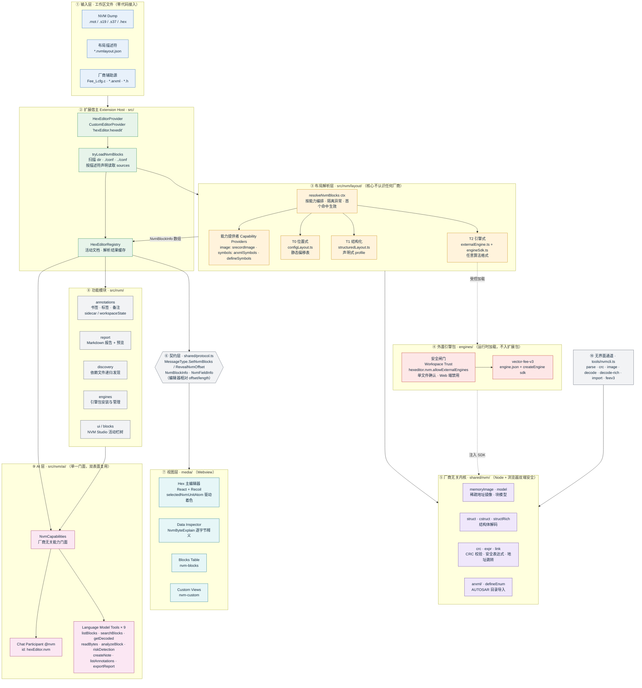

# NVM Studio 软件架构 (Software Architecture)

> 一句话定位：在 VS Code 的 Hex Editor 自定义编辑器之上，构建的 **配置驱动、厂商无关、AI 可用** 的 AUTOSAR NVM Dump 分析平台。

## 架构总图

## 分层说明（演示讲解用）

| 层     | 职责                                                                     | 关键实现                                              |
|--------|--------------------------------------------------------------------------|-------------------------------------------------------|
| ① 输入 | 用户只需放入 dump + 一个 JSON 描述符；描述符自行声明需要哪些辅助源        | `*.nvmlayout.json`                                    |
| ② 宿主 | 拥有文档与编辑模型，负责描述符发现与源文件读取                            | `src/hexEditorProvider.ts`、`src/hexEditorRegistry.ts` |
| ③ 解析 | 核心只讲"能力"（image / symbols / layout / struct / annotations），不讲厂商 | `src/nvm/layout/resolveNvmBlocks`                     |
| ④ 引擎 | 算法型私有格式以独立包形式运行时加载，三重安全闸门                        | `engines/vector-fee-v3`                               |
| ⑤ 内核 | 零 VS Code 依赖，Node/浏览器/CLI 共用                                     | `shared/nvm/`                                         |
| ⑥ 契约 | 宿主与 Webview 的唯一通信面                                              | `shared/protocol.ts`                                  |
| ⑦ 视图 | 选择驱动着色：点哪个单元，才染哪个单元的字段                               | `media/editor/state.ts`                               |
| ⑧ 功能 | 标注、报告、依赖发现、引擎管理                                              | `src/nvm/*`                                           |
| ⑨ AI   | 一个门面同时支撑 `@nvm` 对话与 9 个模型工具                              | `src/nvm/ai/nvmCapabilities.ts`                       |
| ⑩ CLI  | 不启动编辑器即可验证解析链路                                             | `node dist/nvmcli.js`                                 |

## 三条设计主张（可作为结论页）

1. **厂商无关**：`shared/` 与 `src/nvm/layout/` 核心中不出现任何厂商或格式名；新厂商 = 一个描述符，或一个适配器，或一个引擎包。
2. **配置驱动**：没有匹配的描述符时，文件退化为纯 Hex 编辑器，零副作用、零强制。
3. **AI 原生**：解析结果通过统一能力门面暴露，对话与工具调用共享同一份语义，不做二次适配。
